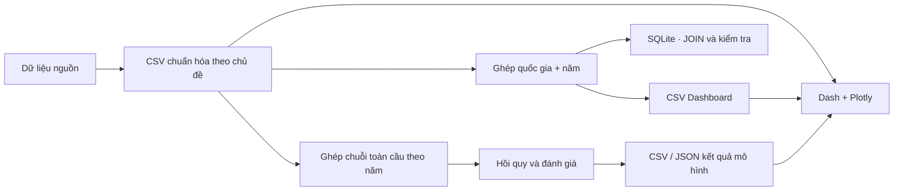

<p align="center">
  
</p>

<h1 align="center">Climate Lab</h1>

<p align="center">
  Dashboard phân tích nhiệt độ, phát thải CO₂ và kịch bản khí hậu toàn cầu.<br>
  Đồ án môn Tương tác dữ liệu trực quan · Nhóm 18 · HCMUTE
</p>

<p align="center">
  
  
  
  <a href="https://climatelab-shipcode.vercel.app/"></a>
</p>

<p align="center">
  <a href="https://climatelab-shipcode.vercel.app/">Demo trực tuyến</a> ·
  <a href="#chay-local">Chạy local</a> ·
  <a href="#kien-truc">Kiến trúc</a> ·
  <a href="#du-lieu">Dữ liệu</a> ·
  <a href="#mo-hinh">Mô hình</a> ·
  <a href="#kiem-thu">Kiểm thử</a>
</p>

## Tổng quan

Climate Lab kết hợp dữ liệu NASA GISTEMP, FAOSTAT, Our World in Data và EDGAR để quan sát biến đổi nhiệt độ, so sánh phát thải giữa các khu vực và mô phỏng các kịch bản CO₂ đến năm 2050. Dự án tổ chức riêng việc làm sạch dữ liệu, phân tích của từng thành viên, ghép bảng, xây dựng mô hình và vận hành Dashboard.

| Hạng mục | Phạm vi hiện tại |
| --- | --- |
| Dashboard | 7 trang chức năng |
| Bảng quốc gia–năm | 39.643 bản ghi, 244 mã quốc gia và vùng lãnh thổ, không trùng khóa |
| Chuỗi toàn cầu dùng cho mô hình | 145 quan sát theo năm, 1880–2024 |
| Cơ sở dữ liệu | 8 bảng và 2 view SQLite |
| Biểu đồ tương tác chuyên đề | 6 biểu đồ nhiệt độ và 6 biểu đồ CO₂ |
| Mô hình | Hồi quy tuyến tính: CO₂ tích lũy → chênh nhiệt độ trung bình trượt 5 năm |

### Các trang chức năng

| Trang | Nội dung |
| --- | --- |
| Tổng quan | Nhóm biểu đồ nhiệt độ, phát thải và kịch bản; lựa chọn trên biểu đồ cập nhật phạm vi phân tích liên quan. |
| Bản đồ khí hậu | Địa cầu ở trung tâm; chọn quốc gia để hiển thị thẻ thông tin tại vị trí tương ứng và xem diễn biến theo năm. |
| Nhiệt độ | Xu hướng, trung bình thập kỷ, bản đồ, châu lục, phân bố quốc gia và chênh nhiệt độ theo tháng. |
| Khí thải CO₂ | Xu hướng, xếp hạng quốc gia, CO₂/người, cơ cấu châu lục, ngành và năng lượng tái tạo. |
| Mô hình dự đoán | Kết quả kiểm tra, chẩn đoán phần dư và kịch bản toàn cầu đến năm 2050. |
| Nhận định | Nhận xét và biểu đồ dẫn chứng theo phạm vi đang chọn. |
| Dữ liệu | Bảng dữ liệu sau lọc và tải CSV; giao diện giới hạn 500 dòng, tệp xuất chứa toàn bộ kết quả lọc. |

Biểu đồ tương tác được bố trí hai cột trên màn hình lớn và có nút mở rộng. Bản đồ hỗ trợ xoay, chuyển phép chiếu và chọn/bỏ chọn quốc gia. Các bản đồ chuyên đề nhiệt độ và CO₂ tự chạy qua những giai đoạn thập kỷ, có điều khiển dừng và thanh chọn thời gian.

<a id="chay-local"></a>

## Cài đặt và chạy local

**Môi trường:** Python 3.12 theo [`.python-version`](.python-version), `pip` và trình duyệt hỗ trợ JavaScript. Thực hiện các lệnh từ thư mục gốc của dự án.

### macOS / Linux

```bash
git clone https://github.com/nguyenkhang310/climate-lab.git
cd climate-lab
python3.12 -m venv .venv
source .venv/bin/activate
python -m pip install -r requirements.txt
python app.py
```

### Windows — PowerShell

```powershell
git clone https://github.com/nguyenkhang310/climate-lab.git
cd climate-lab
py -3.12 -m venv .venv
.venv\Scripts\Activate.ps1
python -m pip install -r requirements.txt
python app.py
```

Mở **[http://127.0.0.1:8050](http://127.0.0.1:8050)**. Dữ liệu đã xử lý, biểu đồ tĩnh và kết quả mô hình được lưu sẵn; không cần chạy lại pipeline để sử dụng Dashboard. Dừng ứng dụng bằng `Ctrl+C` trong terminal.

Nếu dùng ZIP nộp bài, giải nén, mở terminal trong thư mục `climate-lab` và bỏ qua hai lệnh `git clone` / `cd` phía trên. Gói ZIP rút gọn không chứa dữ liệu gốc, notebook, tài liệu thiết kế hoặc bộ kiểm thử; các phần tái tạo và kiểm thử dưới đây cần repository đầy đủ.

Có thể đổi cổng bằng biến `PORT`, ví dụ trên macOS/Linux:

```bash
PORT=8051 python app.py
```

Ứng dụng chạy local tại `127.0.0.1`, không bật chế độ debug. Khi triển khai Vercel, nền tảng sử dụng đối tượng Flask `app` được xuất từ [app.py](app.py), không chạy máy chủ local này.

<a id="kien-truc"></a>

## Kiến trúc và tổ chức mã nguồn



Dashboard đọc các CSV/JSON đã chuẩn bị khi khởi động, rồi lọc và tổng hợp bằng Pandas. Thay đổi bộ lọc không chạy lại làm sạch hoặc huấn luyện mô hình. SQLite dùng để thể hiện quan hệ giữa nhiều bảng và đối chiếu kết quả JOIN, **không phải cơ sở dữ liệu được truy vấn trực tiếp cho mỗi thao tác trên giao diện**.

```text
climate-lab/
├── app.py
├── bang_dieu_khien/nguyen_khang/
│   ├── ung_dung.py                # Dash, bố cục, callback và xuất dữ liệu
│   ├── du_lieu.py                 # Nạp, lọc và tổng hợp dữ liệu
│   ├── bieu_do.py                 # Tổng quan, địa cầu và biểu đồ mô hình
│   ├── thap_ky.py                 # Nhãn và thống kê theo thập kỷ
│   ├── tai_nguyen/                # CSS, JavaScript, logo và ranh giới bản đồ
│   └── kiem_thu/                  # Kiểm thử dữ liệu, callback và trình duyệt
├── phan_tich_nhiet_do/duc/         # Làm sạch, notebook EDA và biểu đồ nhiệt độ
├── phan_tich_co2/quan/             # Làm sạch, EDA và biểu đồ CO₂
├── mo_hinh_du_doan/nguyen_khang/   # Ghép dữ liệu, SQLite và hồi quy
├── data/
│   ├── du_lieu_goc/
│   ├── du_lieu_da_xu_ly/
│   └── ket_qua_mo_hinh/
├── tai_lieu/                      # Nguồn dữ liệu, ERD và tài liệu báo cáo
├── requirements.txt               # Phụ thuộc chạy Dashboard
├── requirements-dev.txt           # Phụ thuộc xử lý dữ liệu, EDA và kiểm thử
└── vercel.json
```

Biểu đồ chuyên đề vẫn được tạo trong mã nguồn của từng thành viên: [nhiệt độ — Đức](phan_tich_nhiet_do/duc/tao_bieu_do_plotly.py) và [CO₂ — Quân](phan_tich_co2/quan/tao_bieu_do_plotly.py). Dashboard gọi các hàm `build_figures(...)` với dữ liệu phù hợp rồi bổ sung bố cục và tương tác. HTML xuất độc lập và Dashboard dùng chung hàm tạo biểu đồ, nhưng phạm vi dữ liệu có thể khác khi áp dụng bộ lọc.

<a id="du-lieu"></a>

## Dữ liệu và quy tắc xử lý

| Nguồn | Nội dung | Phạm vi trong dữ liệu đã xử lý |
| --- | --- | --- |
| [NASA GISTEMP v4](https://data.giss.nasa.gov/gistemp/) | Chênh nhiệt độ toàn cầu theo năm và tháng | 1880–2025; mốc tham chiếu 1951–1980 |
| [FAOSTAT](https://www.fao.org/faostat/en/#data/ET) | Thay đổi nhiệt độ trên đất liền theo quốc gia | 1961–2025 |
| [OWID / Global Carbon Project](https://github.com/owid/co2-data) | CO₂, CO₂/người, dân số và CO₂ tích lũy | Chuỗi toàn cầu 1750–2024; bảng quốc gia ghép giữ 1850–2024 |
| [EDGAR](https://edgar.jrc.ec.europa.eu/report_2026) | CO₂ theo quốc gia và ngành | Nguồn có 1970–2025; phân tích CO₂ chốt đến 2024 |
| [OWID — năng lượng tái tạo](https://ourworldindata.org/grapher/share-of-final-energy-consumption-from-renewable-sources) | Tỷ trọng năng lượng tái tạo trong tiêu thụ năng lượng cuối cùng | 1990–2024; độ phủ năm 2024 còn hạn chế |

### Kết nối và chất lượng dữ liệu

- Khóa bảng quốc gia là `iso_alpha + year`; bảng ngành thêm `sector`, bảng tháng thêm `month`.
- Bảng quốc gia–năm dùng **outer merge** để giữ các bản ghi có chỉ tiêu chưa đầy đủ. Bảng toàn cầu dùng **inner merge theo năm** giữa NASA và dòng `World` của OWID.
- Giữ nguyên giá trị thiếu; không nội suy và không thay bằng `0`. Khi tổng hợp, nhóm không có dữ liệu không được coi là có giá trị bằng không.
- Trang Nhiệt độ giữ chuỗi năm khí tượng FAOSTAT. Bảng ghép với CO₂ dùng nhiệt độ năm lịch tháng 1–12, chỉ tính khi đủ 12 giá trị tháng. Hai cách tính năm này không được sử dụng thay thế cho nhau.
- Chuỗi NASA toàn cầu lấy trực tiếp từ nguồn, không tính bằng trung bình đơn giản của các quốc gia. CO₂ toàn cầu cũng dùng dòng `World`, không thay bằng tổng các quốc gia đang có dữ liệu.
- CO₂ tích lũy giữ phần cộng dồn từ năm 1750, không bắt đầu tính lại ở năm 1880.
- EDGAR được lọc riêng khí CO₂. `ANT` có tên Curaçao được chuẩn hóa thành `CUW`; `SCG` giữ chuỗi Serbia và Montenegro gộp chung, không phân bổ tùy ý cho từng nước.

Chi tiết: [tổ chức dữ liệu](https://github.com/nguyenkhang310/climate-lab/blob/main/data/README.md), [báo cáo ghép](data/du_lieu_da_xu_ly/nguyen_khang/bao_cao_ghep_du_lieu.json), [sơ đồ quan hệ](https://github.com/nguyenkhang310/climate-lab/blob/main/tai_lieu/dung_chung/SO_DO_DU_LIEU.md) và [ERD](https://github.com/nguyenkhang310/climate-lab/blob/main/tai_lieu/dung_chung/SO_DO_ERD.svg).

### Phạm vi của bộ lọc

Khoảng thời gian, châu lục và quốc gia áp dụng cho các biểu đồ thống kê tương ứng. Lựa chọn chỉ số nhiệt độ/CO₂ thay đổi lớp màu bản đồ, không chuyển đổi nội dung của mọi biểu đồ.

Các bản đồ chuyên đề hiển thị **trung bình theo những giai đoạn thập kỷ** và giữ bộ điều khiển thời gian riêng; các mốc này không phải giá trị của một năm đơn lẻ. Biểu đồ PNG là kết quả xuất sẵn, không thay đổi khi lọc. Trang mô hình và các kịch bản dự đoán giữ **phạm vi toàn cầu**, không suy ra dự báo cấp quốc gia từ mô hình toàn cầu.

<a id="mo-hinh"></a>

## Mô hình dự đoán

[mo_hinh_nhiet_do.py](mo_hinh_du_doan/nguyen_khang/mo_hinh_nhiet_do.py) sử dụng hồi quy tuyến tính đơn biến với đầu vào **CO₂ tích lũy (GtCO₂)** và mục tiêu **chênh nhiệt độ trung bình trượt 5 năm**, tính từ năm hiện tại và bốn năm trước đó.

Quy trình đánh giá:

1. Từ 145 năm 1880–2024, tạo 141 quan sát hợp lệ 1884–2024 sau trung bình trượt.
2. So sánh các mốc lịch sử 1880, 1961 và 1970 bằng bốn lượt kiểm chứng 5 năm trong 1995–2014, với tập huấn luyện mở rộng. Phương án 1880 đạt MAE trung bình thấp nhất trong ba phương án: **0,0360°C**.
3. Huấn luyện trên **1884–2014**, giữ riêng **2015–2024** để kiểm tra cuối cùng. Không trộn ngẫu nhiên các năm hoặc sử dụng tập kiểm tra để chọn mốc lịch sử.
4. Sau khi đánh giá, học lại toàn bộ **1884–2024** để tạo các kịch bản **2025–2050**.

| Chỉ số trên tập kiểm tra 2015–2024 | Giá trị |
| --- | ---: |
| R² | 0,823 |
| MAE | 0,0307°C |
| RMSE | 0,0370°C |

Các chỉ số được tính trên nhiệt độ đã làm trơn và sử dụng CO₂ tích lũy thực tế của các năm kiểm tra. **R² = 0,823 không có nghĩa độ chính xác là 82,3%.**

Ba kịch bản mặc định gồm tiếp diễn tốc độ phát thải gần đây, giữ mức phát thải năm 2024 và giảm 5% mỗi năm. Người dùng có thể điều chỉnh tỷ lệ phát thải và so sánh tại 2030, 2040 hoặc 2050.

Dải dự đoán 90% dùng lấy mẫu lại phần dư theo khối vòng tròn, 2.000 lần với seed `18`; độ dài khối được chọn trong khoảng 5–15 năm và hiện là 10 năm. Dải được tính **theo từng năm**, với đường CO₂ của kịch bản được coi là đã xác định. Phương pháp không bảo đảm độ chính xác 90% và không bao gồm toàn bộ bất định của phát thải tương lai hay các yếu tố khí hậu chưa được mô hình hóa.

Kết quả là mô phỏng thống kê phục vụ đồ án, không phải dự báo khí hậu chính thức. Các giá trị dùng mốc NASA 1951–1980, không được so sánh trực tiếp với ngưỡng Paris dùng mốc tiền công nghiệp. Dữ liệu đầu ra và thông số nằm trong [data/ket_qua_mo_hinh/nguyen_khang](data/ket_qua_mo_hinh/nguyen_khang).

## Tái tạo dữ liệu và biểu đồ

Phần này cần repository đầy đủ và dữ liệu nguồn trong `data/du_lieu_goc`. Cài phụ thuộc phát triển trong môi trường ảo đã kích hoạt:

```bash
python -m pip install -r requirements-dev.txt
```

Chạy lần lượt:

```bash
python phan_tich_nhiet_do/duc/lam_sach_du_lieu.py
python phan_tich_co2/quan/lam_sach_du_lieu.py
python mo_hinh_du_doan/nguyen_khang/ghep_du_lieu.py
python mo_hinh_du_doan/nguyen_khang/tao_co_so_du_lieu.py
python mo_hinh_du_doan/nguyen_khang/mo_hinh_nhiet_do.py
```

Xuất lại biểu đồ tương tác và biểu đồ tĩnh CO₂:

```bash
python phan_tich_nhiet_do/duc/tao_bieu_do_plotly.py
python phan_tich_co2/quan/tao_bieu_do_plotly.py
python phan_tich_co2/quan/tao_eda.py
```

Biểu đồ tĩnh nhiệt độ được tạo trong [notebook EDA của Đức](https://github.com/nguyenkhang310/climate-lab/blob/main/phan_tich_nhiet_do/duc/01_lam_sach_va_eda.ipynb). HTML xuất độc lập sử dụng Plotly qua CDN nên cần kết nối mạng khi mở.

**Lưu ý:** các lệnh tái tạo ghi lại tệp đầu ra CSV, JSON, SQLite hoặc biểu đồ tương ứng. Giữ nguyên dữ liệu gốc và khởi động lại Dashboard sau khi thay đổi dữ liệu để ứng dụng nạp bản mới.

<a id="kiem-thu"></a>

## Kiểm thử

Bộ kiểm thử cần repository đầy đủ và `requirements-dev.txt`. Chạy kiểm tra dữ liệu, SQLite, biểu đồ, bộ lọc, callback và mô hình:

```bash
python -m unittest discover -s bang_dieu_khien/nguyen_khang/kiem_thu -p "test_*.py"
```

**Kết quả xác nhận ngày 14/10/2026: 97/97 kiểm thử đạt.** Đây là kết quả của các trường hợp đã xây dựng, không phải bảo đảm mọi tình huống sử dụng đều không có lỗi. Repository hiện chưa cấu hình workflow CI tự động.

Kiểm tra giao diện bằng Playwright:

```bash
python -m playwright install chromium
python app.py
```

Giữ ứng dụng chạy và mở terminal thứ hai với cùng môi trường ảo:

```bash
python bang_dieu_khien/nguyen_khang/kiem_thu/browser_smoke.py
```

Script kiểm tra các trang, thao tác bản đồ, chọn/bỏ chọn, mở rộng biểu đồ và kích thước màn hình; ảnh kiểm tra được lưu trong thư mục tạm của hệ điều hành. Nếu đổi cổng ứng dụng, đặt `BASE_URL` tương ứng khi chạy script.

## Triển khai Vercel

Dự án có sẵn [vercel.json](vercel.json), sử dụng preset **Flask**, entrypoint `app.py`, Python 3.12 và vùng `sin1`. Bundle không chứa môi trường ảo, dữ liệu gốc, SQLite, notebook, tài liệu và bộ kiểm thử; Dashboard vẫn đọc CSV/JSON đã xử lý.

1. Import repository `nguyenkhang310/climate-lab` trong Vercel.
2. Giữ Root Directory là `./` và preset Flask; dùng cấu hình trong repository.
3. Chọn `main` làm Production Branch và triển khai.

Khi đã kết nối Git và bật tự động triển khai, push lên nhánh production sẽ tạo deployment mới. Nếu deployment lỗi, kiểm tra cả build log và runtime log; build thành công không bảo đảm ứng dụng chạy thành công.

Tham khảo: [Flask trên Vercel](https://vercel.com/docs/frameworks/backend/flask), [triển khai từ Git](https://vercel.com/docs/git).

## Xử lý sự cố thường gặp

- **Thiếu module:** kích hoạt đúng môi trường ảo, cài `requirements.txt`; tác vụ EDA và kiểm thử cần thêm `requirements-dev.txt`.
- **Cổng 8050 đang được dùng:** dừng tiến trình ứng dụng cũ hoặc đổi `PORT`.
- **PNG không đổi khi lọc:** đây là ảnh xuất sẵn; dùng biểu đồ tương tác để xem theo phạm vi đang chọn.
- **Một quốc gia thiếu chỉ tiêu:** kiểm tra năm và độ phủ dữ liệu; giá trị thiếu không phải bằng không.
- **Dữ liệu mới chưa hiển thị:** chạy lại đúng bước tạo dữ liệu và khởi động lại ứng dụng.

## Nhóm thực hiện

| Thành viên | Phụ trách |
| --- | --- |
| Huỳnh Cao Trung Đức | Thu thập, làm sạch, EDA và trực quan hóa nhiệt độ. |
| Phạm Thế Quân | Thu thập, làm sạch, EDA và trực quan hóa CO₂, năng lượng tái tạo. |
| Bùi Nguyễn Nguyên Khang | Ghép dữ liệu, SQLite, Dashboard, tương tác và mô hình dự đoán. |

Nhận định chuyên đề: [Nhiệt độ](phan_tich_nhiet_do/duc/NHAN_DINH.md) · [CO₂](phan_tich_co2/quan/NHAN_DINH.md).
