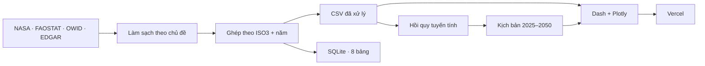

<p align="center">
  
</p>

<h1 align="center">Climate Lab</h1>

<p align="center">
  <strong>Dashboard tương tác phân tích nhiệt độ, CO₂ và xu hướng khí hậu toàn cầu</strong>
</p>

<p align="center">
  Đồ án môn Tương tác dữ liệu trực quan · Nhóm 18 · HCMUTE
</p>

<p align="center">
  
  
  
  
  <a href="https://climatelab-shipcode.vercel.app/"></a>
</p>

<p align="center">
  <a href="https://climatelab-shipcode.vercel.app/"><strong>Mở Dashboard</strong></a>
  ·
  <a href="#cài-đặt-và-chạy-local">Cài đặt</a>
  ·
  <a href="#dữ-liệu-và-phương-pháp">Dữ liệu</a>
  ·
  <a href="#mô-hình-dự-đoán">Mô hình</a>
</p>

---

## Giới thiệu

Climate Lab kết hợp dữ liệu **nhiệt độ**, **lượng CO₂**, **dân số**, **CO₂ bình quân đầu người** và **năng lượng tái tạo** trong một hệ thống trực quan thống nhất. Dashboard được xây dựng để trả lời ba câu hỏi:

1. Khí hậu đã thay đổi như thế nào theo thời gian?
2. Mức độ thay đổi khác nhau ra sao giữa các quốc gia và châu lục?
3. Nhiệt độ có thể diễn biến thế nào đến năm 2050 dưới các kịch bản CO₂ khác nhau?

Hệ thống bao quát toàn bộ quy trình của đồ án: thu thập dữ liệu, làm sạch, kết nối nhiều bảng, khám phá dữ liệu, kể chuyện bằng biểu đồ, xây dựng mô hình hồi quy và triển khai ứng dụng web.

## Điểm nổi bật

| Hạng mục | Kết quả |
| --- | --- |
| Phạm vi quốc gia | 244 quốc gia và vùng lãnh thổ |
| Bảng quốc gia–năm | 39.643 dòng, không có khóa trùng |
| Chuỗi khí hậu toàn cầu | 1880–2024 |
| Cơ sở dữ liệu | 8 bảng SQLite có khóa liên kết |
| Biểu đồ phân tích | 6 biểu đồ nhiệt độ và 6 biểu đồ CO₂ |
| Mô hình | Hồi quy tuyến tính theo thời gian |
| Kết quả kiểm tra | R² = 0,823 · MAE = 0,031°C |
| Dự báo | 3 kịch bản CO₂ đến năm 2050 |
| Kiểm thử | 97 ca kiểm thử tự động |

## Chức năng Dashboard

| Trang | Nội dung |
| --- | --- |
| **Tổng quan** | Tóm tắt nhiệt độ, CO₂, xếp hạng quốc gia và cơ cấu theo châu lục. |
| **Bản đồ khí hậu** | Chuyển đổi giữa địa cầu và bản đồ phẳng; chọn quốc gia, chỉ số và thời gian. |
| **Nhiệt độ** | Phân tích xu hướng toàn cầu, thập kỷ, quốc gia, châu lục và phân bố dữ liệu. |
| **Khí thải CO₂** | Phân tích xu hướng, xếp hạng, bản đồ, cơ cấu ngành và năng lượng tái tạo. |
| **Mô hình dự đoán** | So sánh các kịch bản CO₂ và đường nhiệt độ dự đoán đến năm 2050. |
| **Nhận định** | Tổng hợp câu chuyện từ dữ liệu theo phạm vi người dùng đang xem. |
| **Dữ liệu** | Xem bảng dữ liệu sau lọc và tải xuống định dạng CSV. |

### Tương tác chính

- Lọc đồng bộ theo **thập kỷ, châu lục và quốc gia**.
- Bấm trực tiếp một quốc gia trên bản đồ để cập nhật phạm vi phân tích.
- Kéo để xoay địa cầu; chuyển nhanh sang phép chiếu bản đồ phẳng.
- Tự động phát bản đồ theo các mốc 10 năm và có nút dừng.
- Mở rộng từng biểu đồ mà không làm thay đổi bố cục sau khi đóng.
- Xuất dữ liệu đang xem thành CSV.
- Chọn kịch bản và mốc 2030, 2040 hoặc 2050 trong trang dự đoán.

## Kiến trúc hệ thống



### Công nghệ sử dụng

| Nhóm | Công nghệ | Vai trò |
| --- | --- | --- |
| Xử lý dữ liệu | Python, Pandas, NumPy | Làm sạch, ghép, lọc và tổng hợp dữ liệu |
| Trực quan hóa | Plotly | Biểu đồ tương tác, choropleth và địa cầu |
| Ứng dụng web | Dash, Flask | Giao diện, callback và máy chủ ứng dụng |
| Mô hình | Scikit-learn | Hồi quy tuyến tính và đánh giá mô hình |
| Cơ sở dữ liệu | SQLite | Tổ chức nhiều bảng và minh họa thao tác JOIN |
| Giao diện | HTML, CSS, JavaScript | Bố cục responsive và tương tác phía trình duyệt |
| Triển khai | GitHub, Vercel | Quản lý phiên bản và tự động triển khai |

## Dữ liệu và phương pháp

### Nguồn dữ liệu

| Chủ đề | Nguồn | Mục đích sử dụng |
| --- | --- | --- |
| Nhiệt độ toàn cầu | [NASA GISTEMP v4](https://data.giss.nasa.gov/gistemp/) | Độ lệch nhiệt độ so với trung bình 1951–1980 |
| Nhiệt độ quốc gia | [FAOSTAT](https://www.fao.org/faostat/en/#data/ET) | So sánh theo quốc gia, khu vực và thời gian |
| CO₂ và dân số | [Our World in Data](https://github.com/owid/co2-data) | CO₂ toàn cầu, quốc gia và bình quân đầu người |
| CO₂ theo ngành | [EDGAR](https://edgar.jrc.ec.europa.eu/report_2026) | Phân tích cơ cấu CO₂ theo lĩnh vực |
| Năng lượng tái tạo | [Our World in Data](https://ourworldindata.org/grapher/share-of-final-energy-consumption-from-renewable-sources) | Đối chiếu với CO₂ bình quân đầu người |

### Quy tắc xử lý

- Các bảng quốc gia được nối bằng khóa **`iso_alpha + year`**.
- Sử dụng **full outer join** để không làm mất những năm chỉ có một phần dữ liệu.
- Giá trị thiếu được giữ nguyên, không nội suy và không thay bằng 0.
- Kiểm tra khóa trùng trước và sau khi ghép.
- Dữ liệu nhiệt độ năm lịch chỉ được tính khi đủ 12 tháng.
- Bảng toàn cầu chỉ giữ những năm có đồng thời dữ liệu NASA và CO₂.
- `SCG` được giữ như chuỗi Serbia và Montenegro gộp chung, không gán cho từng quốc gia hiện tại.

Các kết quả kiểm tra nằm trong [`bao_cao_ghep_du_lieu.json`](data/du_lieu_da_xu_ly/nguyen_khang/bao_cao_ghep_du_lieu.json). Phần nhận định chi tiết nằm tại [Nhiệt độ](phan_tich_nhiet_do/duc/NHAN_DINH.md) và [CO₂](phan_tich_co2/quan/NHAN_DINH.md).

## Mô hình dự đoán

Mô hình hồi quy tuyến tính sử dụng **CO₂ tích lũy toàn cầu** để ước lượng **độ lệch nhiệt độ trung bình trượt 5 năm**:

```text
Nhiệt độ trung bình 5 năm = hệ số chặn + hệ số × CO₂ tích lũy
```

| Giai đoạn | Vai trò |
| --- | --- |
| 1880–1883 | Chưa đủ cửa sổ 5 năm nên không đưa vào mô hình |
| 1884–2014 | Huấn luyện |
| 2015–2024 | Kiểm tra độc lập theo thời gian |
| 2025–2050 | Xây dựng kịch bản |

Kết quả trên tập kiểm tra:

| Chỉ số | Giá trị |
| --- | ---: |
| R² | 0,823 |
| MAE | 0,031°C |
| RMSE | 0,037°C |

Ba kịch bản được trình bày trên Dashboard:

- **Tiếp diễn xu hướng:** CO₂ thay đổi theo tốc độ gần đây.
- **Giữ mức 2024:** lượng CO₂ hằng năm không đổi.
- **Giảm 5% mỗi năm:** lượng CO₂ giảm dần từ năm 2025.

Đây là mô hình phục vụ phân tích xu hướng trong phạm vi đồ án, không phải mô hình khí hậu vật lý. Kết quả thể hiện mối liên hệ thống kê và không được diễn giải như quan hệ nhân quả hoàn chỉnh.

## Cấu trúc dự án

```text
climate-lab/
├── app.py                         # Điểm chạy ứng dụng
├── bang_dieu_khien/nguyen_khang/  # Giao diện, dữ liệu và biểu đồ Dashboard
├── data/
│   ├── du_lieu_goc/               # Dữ liệu nguồn
│   ├── du_lieu_da_xu_ly/          # Dữ liệu sạch và SQLite
│   └── ket_qua_mo_hinh/           # Dự đoán, phần dư và thông số mô hình
├── phan_tich_nhiet_do/duc/        # Làm sạch và phân tích nhiệt độ
├── phan_tich_co2/quan/            # Làm sạch và phân tích CO₂
├── mo_hinh_du_doan/nguyen_khang/  # Ghép dữ liệu và mô hình hồi quy
├── tai_lieu/dung_chung/           # ERD, nguồn dữ liệu và tài liệu chung
├── requirements.txt               # Thư viện chạy Dashboard
├── requirements-dev.txt           # Thư viện xử lý, EDA và kiểm thử
└── vercel.json                    # Cấu hình triển khai
```

## Cài đặt và chạy local

### macOS hoặc Linux

```bash
git clone https://github.com/nguyenkhang310/climate-lab.git
cd climate-lab
python3.12 -m venv .venv
source .venv/bin/activate
pip install -r requirements.txt
python app.py
```

### Windows

```powershell
git clone https://github.com/nguyenkhang310/climate-lab.git
cd climate-lab
py -3.12 -m venv .venv
.venv\Scripts\activate
pip install -r requirements.txt
python app.py
```

Mở [http://127.0.0.1:8050](http://127.0.0.1:8050). Dữ liệu đã xử lý và kết quả mô hình được lưu sẵn nên không cần chạy lại pipeline để xem Dashboard.

## Tái tạo dữ liệu và mô hình

> Phần này cần repository đầy đủ có thư mục `data/du_lieu_goc`. Gói mã nguồn rút gọn chỉ chứa dữ liệu đã xử lý để chạy Dashboard.

Cài các thư viện dành cho phát triển:

```bash
pip install -r requirements-dev.txt
```

Chạy pipeline theo thứ tự:

```bash
python phan_tich_nhiet_do/duc/lam_sach_du_lieu.py
python phan_tich_co2/quan/lam_sach_du_lieu.py
python mo_hinh_du_doan/nguyen_khang/ghep_du_lieu.py
python mo_hinh_du_doan/nguyen_khang/tao_co_so_du_lieu.py
python mo_hinh_du_doan/nguyen_khang/mo_hinh_nhiet_do.py
```

## Kiểm thử

Chạy toàn bộ kiểm thử dữ liệu, biểu đồ, callback và mô hình:

```bash
python -m unittest discover -s bang_dieu_khien/nguyen_khang/kiem_thu -p "test_*.py"
```

Kiểm thử giao diện bằng trình duyệt:

```bash
python -m playwright install chromium
python app.py
# Mở terminal thứ hai
python bang_dieu_khien/nguyen_khang/kiem_thu/browser_smoke.py
```

Kết quả hiện tại: **97/97 kiểm thử đạt**.

## Triển khai Vercel

Repository đã có sẵn `vercel.json`. Trên Vercel:

1. Chọn **Add New → Project**.
2. Import repository `nguyenkhang310/climate-lab`.
3. Giữ `Root Directory` là `./` và preset **Flask**.
4. Chọn **Deploy**.

Sau khi kết nối GitHub, mỗi lần push lên nhánh `main` sẽ tự động tạo deployment mới. Không cần API key hoặc biến môi trường.

## Nhóm thực hiện

| Thành viên | Phụ trách |
| --- | --- |
| **Huỳnh Cao Trung Đức** | Làm sạch dữ liệu, EDA và trực quan nhiệt độ |
| **Phạm Thế Quân** | Làm sạch dữ liệu, EDA và trực quan CO₂ |
| **Bùi Nguyễn Nguyên Khang** | Ghép dữ liệu, SQLite, Dashboard và mô hình dự đoán |

---

<p align="center">
  <strong>Climate Lab · Nhóm 18 · HCMUTE</strong><br>
  Từ dữ liệu đến trực quan, từ trực quan đến nhận định.
</p>
